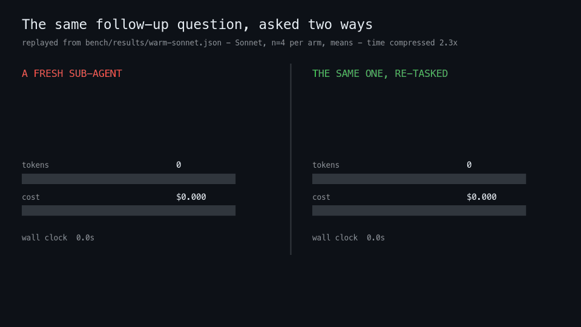

# open-primeagent

[English](README.md) · [한국어](README.ko.md) · [简体中文](README.zh-CN.md) · **日本語**

<sub>英語版 README の最初の画面だけを訳したものです。全体と最新の内容は[英語版 README](README.md) にあります。</sub>

**Claude Code はサブエージェントを雇います。サブエージェントはリポジトリの半分を読みます。
Claude Code はそれを解雇し、次は新しく雇ったサブエージェントがまた全部読み直します。**



<sub>[実測データ](bench/results/warm-sonnet.json)（Sonnet、n=4、平均）を再生したもので、演出ではありません。[`bench/demo.py`](bench/demo.py) で作り直せます。</sub>

open-primeagent はサブエージェントを残しておきます。あとから追加で質問しても、コードを覚えています。
いま使っているエージェント（Claude Code、Codex、opencode）に MCP サーバーを 1 つ足すだけで、やることは 3 つです。

- **セッションが終わっても残るサブエージェント。** すでにコードを読んだサブエージェントに次の仕事を頼むと、
  新しく立ち上げるよりコストが 81% 少なく済みました。
- **忘れられないプロジェクトのルール。** エージェントが学んだことを、もともと読んでいる `CLAUDE.md` や `AGENTS.md` に書きます。
  書くのは目印で囲んだブロック 1 つの中だけで、`opa_bootstrap(remove=True)` でそのまま取り除けます。
  ルールを見つけ直すのが難しいタスクでは、かかった時間が 57% 短くなりました。
- **呼び出しの合間も生きている Python プロセス。** コンテキストウィンドウに置きたくない状態をしまっておけます。
  ただ、役に立つことはまだ示せていません。ベンチマークの 120 ターンで、エージェントは一度も呼びませんでした。

```bash
claude mcp add opa -- uvx open-primeagent
# または、スキル付きの Claude Code プラグインとして：
# /plugin install open-primeagent --marketplace softkleenex/open-primeagent
```

### 負けたベンチマーク

| 実験 | 結果 | |
|---|---|---|
| 新しく立ち上げず、コードを読み終えたサブエージェントに頼み直す | コスト 81% 減 | 勝ち |
| 16 個のおとりスクリプトに埋もれた知識をルールとして記録 | かかった時間 57% 減、ばらつきも縮小 | 勝ち |
| 同じルールで、答えがすぐ目に入る場合 | ターン数 26% 増 | 負け |
| 新しいサブエージェント 4 つに分担 | コスト 777% 増 | 負け |
| 分担が勝つように作った 444 ファイルのコードベースで分担 | かかった時間 127% 増 | 負け |
| 永続カーネルを 120 ターンつないだまま | 呼び出し 0 回 | 効果なし |

負けた結果も消しません。勝った結果を信じられるものにしているのは負けた結果で、
なぜ負けたかのほうが数字より役に立ちます。[生データと測定方法](bench/README.md)

コードにも同じ基準を当てています。この README はかつて「ブロックの外は 1 文字も変えない」と約束していました。
外部レビューでそれが破れる入力が見つかり、[経緯は開発ログにあります](docs/journal.md#an-outside-review-breaks-the-headline-promise-2026-11-25)。
いまは安全装置すべてに[ミューテーションテスト](scripts/mutate_guards.py)をかけています。わざと壊して、テストが落ちることを確かめます。

**[残りのドキュメント（英語）→](README.md#install)**
