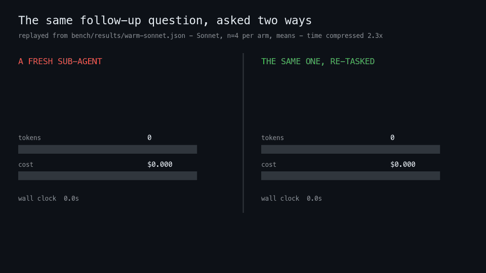

# open-primeagent

[English](README.md) · **한국어** · [简体中文](README.zh-CN.md) · [日本語](README.ja.md)

<sub>영어 README의 첫 화면만 옮긴 문서입니다. 전체 문서와 최신 내용은 [영어 README](README.md)에 있습니다.</sub>

**Claude Code는 서브에이전트를 고용합니다. 서브에이전트는 저장소를 절반쯤 읽습니다.
Claude Code는 그 서브에이전트를 해고하고, 다음번에 새로 고용한 서브에이전트가 처음부터 다시 다 읽습니다.**



<sub>[측정 데이터](bench/results/warm-sonnet.json)(Sonnet, n=4, 평균)를 재생한 화면이고, 연출한 게 아닙니다. [`bench/demo.py`](bench/demo.py)로 다시 만들 수 있습니다.</sub>

open-primeagent는 서브에이전트를 남겨 둡니다. 나중에 후속 질문을 보내도 코드를 기억하고 있습니다.
이미 쓰고 있는 에이전트(Claude Code, Codex, opencode)에 MCP 서버 하나만 추가하면 되고, 하는 일은 세 가지입니다.

- **세션이 끝나도 남는 서브에이전트.** 이미 코드를 읽은 서브에이전트에게 다시 일을 시켰더니,
  새로 만들 때보다 비용이 81% 적었습니다.
- **잊히지 않는 프로젝트 규칙.** 에이전트가 알아낸 것을 원래 읽는 `CLAUDE.md`나 `AGENTS.md`에 적어 둡니다.
  표시해 둔 블록 하나 안에만 쓰고, `opa_bootstrap(remove=True)`로 그대로 걷어낼 수 있습니다.
  규칙을 다시 찾아내기 어려운 과제에서는 걸린 시간이 57% 줄었습니다.
- **호출 사이에도 살아 있는 Python 프로세스.** 컨텍스트 창에 두기 싫은 상태를 담아 둡니다.
  다만 도움이 된다는 건 아직 보여 주지 못했습니다. 벤치마크 120턴 동안 에이전트가 한 번도 부르지 않았습니다.

```bash
claude mcp add opa -- uvx open-primeagent
# 또는 스킬까지 포함한 Claude Code 플러그인으로:
# /plugin install open-primeagent --marketplace softkleenex/open-primeagent
```

### 우리가 진 벤치마크

| 실험 | 결과 | |
|---|---|---|
| 새로 만드는 대신, 이미 코드를 읽은 서브에이전트에게 다시 일 시키기 | 비용 81% 감소 | 이김 |
| 미끼 스크립트 16개 사이에 숨어 있던 지식을 규칙으로 기록 | 걸린 시간 57% 감소, 편차도 줄어듦 | 이김 |
| 같은 규칙인데 답이 바로 보이는 경우 | 턴 수 26% 증가 | 짐 |
| 새 서브에이전트 4개에게 나눠 맡기기 | 비용 777% 증가 | 짐 |
| 나눠 맡기기가 이기도록 만든 444개 파일짜리 코드베이스에서 | 걸린 시간 127% 증가 | 짐 |
| 영속 커널을 120턴 동안 붙여 둠 | 호출 0회 | 효과 없음 |

진 결과도 지우지 않습니다. 이긴 결과를 믿을 수 있게 해 주는 게 진 결과이고,
왜 졌는지가 숫자보다 쓸모 있습니다. [원본 데이터와 측정 방법](bench/README.md)

코드에도 같은 기준을 둡니다. 이 README는 한때 "블록 밖은 한 글자도 바꾸지 않는다"고 약속했습니다.
외부 리뷰에서 그 약속이 깨지는 입력이 나왔고, [경위는 개발 일지에 있습니다](docs/journal.md#an-outside-review-breaks-the-headline-promise-2026-11-25).
지금은 모든 안전장치에 [뮤테이션 테스트](scripts/mutate_guards.py)를 겁니다. 일부러 망가뜨려 보고 테스트가 실패하는지 확인합니다.

**[나머지 문서 (영어) →](README.md#install)**
