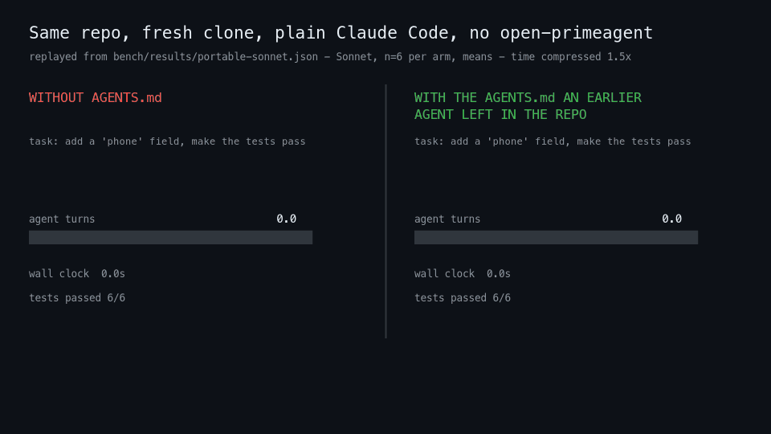

# open-primeagent

<!-- mcp-name: io.github.softkleenex/open-primeagent -->

[](https://github.com/softkleenex/open-primeagent/actions/workflows/ci.yml)
[](https://pypi.org/project/open-primeagent/)
[](pyproject.toml)
[](LICENSE)
[](tests/test_upstream_compat.py)

**English** · [한국어](README.ko.md) · [简体中文](README.zh-CN.md) · [日本語](README.ja.md)

<!-- i18n:begin  translated in README.ko.md, README.zh-CN.md, README.ja.md; tests/test_readme_i18n.py keeps the numbers in sync -->

**Claude Code spends half an hour learning your repo. Then a teammate opens it
in Codex, and Codex knows none of it.**

Each agent remembers on its own now, and keeps it to itself: Claude Code in
`~/.claude`, Codex in `~/.codex`, on the machine that wrote it.
open-primeagent writes what your agent learned into the repo's `AGENTS.md` and
`CLAUDE.md`, inside one marked block, so it is committed with the code and read
by Claude Code, Codex and opencode alike.



<sub>Replayed from [measured data](bench/results/portable-deep-sonnet.json) (Sonnet, n=6 per arm, means), not staged. On a rule that is easy to rediscover the gain is about half: [26%](bench/README.md#p-a-rule-learned-by-one-agent-used-by-the-next-one-without-us---wins-more-when-the-rule-is-hard). [`bench/demo_portable.py`](bench/demo_portable.py) renders it.</sub>

It is one MCP server, added to whichever of the three you run:

- **Rules that travel with the repo.** In one session, Claude Code with
  open-primeagent found a repo's hidden rule and recorded it. A fresh clone
  carrying only the resulting `AGENTS.md`, opened by plain Claude Code with no
  open-primeagent at all, finished the same task with 51% fewer turns and 51%
  less time when the rule was hard to rediscover, and 26% fewer when it was easy. The block comes back out cleanly with `opa_bootstrap(remove=True)`.
- **Sub-agents across agents.** From Claude Code you can keep a Codex sub-agent
  and come back to it with a follow-up. Claude Code, Codex and opencode can each
  resume their own sub-agents now; none of them can reach the others'. (The
  Codex child was checked against the real CLI by hand; CI uses a stub.)
- **A Python process that stays alive between calls**, for state you would
  rather not keep in the context window. We have not shown that this helps: in
  120 turns of our benchmarks the agent never called it.

```bash
claude mcp add opa -- uvx open-primeagent
# Codex and opencode: see Install below. Or, in Claude Code, as a plugin:
# /plugin install open-primeagent --marketplace softkleenex/open-primeagent
```

### The benchmarks we lost

| experiment | result | |
|---|---|---|
| a rule learned with open-primeagent, read from `AGENTS.md` by a fresh agent without it, when three decoys write plausible wrong output | 51% fewer turns, 51% less time | won |
| the same, when the rule is easy to rediscover | 26% fewer turns, 26% less time | won, modestly |
| the same, first version: the agent filed the rule as a memory, which other agents only see as a title | the key fact reached the next agent in 4 of 6 runs | lost, fixed: 6 of 6 |
| a recorded rule, when the knowledge was hidden among 16 decoy scripts (August) | 57% less wall clock, variance collapsed | won |
| the same rule, when the knowledge was one glance away | 26% more turns | lost |
| re-task a warm sub-agent instead of starting a cold one | 81% less cost | won, but the hosts now do this natively |
| fan out to 4 fresh sub-agents | 777% more cost | lost |
| fan out on a 444-file codebase built for fan-out to win | 127% more wall clock | lost |
| persistent kernel attached for 120 turns | called 0 times | no effect |

The losses stay in. They are what makes the wins believable, and why each one
lost is more useful than the number. [Raw data and methodology.](bench/README.md)

We hold ourselves to the same rule. This README used to lead with sub-agents
that survive the session. While comparing ourselves with the hosts, we found
that Claude Code, Codex and opencode had all shipped that natively during 2026,
so it is no longer the headline. It also used to promise that projection never
changes a character outside its block; an outside review found inputs where it
did, and [the journal has the details](docs/journal.md#an-outside-review-breaks-the-headline-promise-2026-11-25).
Every safety guard is now [mutation-tested](scripts/mutate_guards.py): we break
it on purpose and check that a test fails.

<!-- i18n:end -->

[Install](#install) · [Why not just use Prime Agent](#why-it-plugs-into-your-agent-instead-of-replacing-it) ·
[Is it really the same RLM?](#is-it-really-the-same-rlm) ·
[Sub-agents](#persistent-sub-agents-actually-work) ·
[External memory](#context-is-for-deciding-not-for-storage) ·
[Harness](#a-harness-that-learns-without-touching-your-files) ·
[Benchmarks](#benchmarks-including-the-ones-we-lost) ·
[Evolution](#can-an-agent-evolve-mid-session) ·
[Security](#-not-a-sandbox) · [Docs](docs/)

---

| layer | what it adds | how it is verified |
|---|---|---|
| L1 persistent Python | a kernel that outlives each call, output truncation | a real IPython kernel, in CI |
| L2 sub-agents | spawn, resume, agent-to-agent messages | claude-code: a real child agent, in CI. codex: by hand, once |
| L3 harness | prompts, memory, skills, sub-agent specs, projection into your files | in CI |
| L4 long-run | goal, schedule, autonomous loop behind a gate command | in CI |
| L5 evolution | rewriting its own tool description mid-session, `harness.evolve()` | in CI |

About codex: the adapter was checked against the real CLI by hand when it was
written (`43db9fd`, a child resumed with its context intact). Since then only a
stub CLI exercises it, because the codex login on this machine expired. If you
run it against real codex, please tell us what breaks.

It reimplements the `rlm` protocol from Prime Intellect's
[Prime Agent](https://github.com/PrimeIntellect-ai/prime-agent): same request
names, same field names, same state-file schema, [pinned by a test](tests/test_upstream_compat.py).
Phase exit criteria are in [the roadmap](docs/roadmap.md).

---

## Why it plugs into your agent instead of replacing it

[Prime Agent](https://github.com/PrimeIntellect-ai/prime-agent) is a whole coding
agent: its own terminal UI, provider layer, login and daemon. To use its ideas
you move into it. When this project started (upstream snapshot `f8f0036`,
2026-08-18) that agent was about 170k lines of TypeScript, and the `rlm`
runtime the model actually talks to was 1,536 of them. Upstream has since been
rewritten in Rust and keeps growing (v0.10.5, November 2026); the proportion is
the point, not the exact count. The idea is small. The agent around it is big.

You already have an agent around it. Claude Code, Codex and opencode each
bring sessions, auth, model choice, permissions, plugins and a UI you are used
to. So open-primeagent builds only the small part, about 4,800 lines of Python
(6,100 counting blank lines and comments), and leaves everything else to the
agent you already run. Which also means the same harness serves all three.

## Is it really the same RLM?

Fair question, and the kind that is usually answered with adjectives. Here it is
answered by a CI test that reproduces upstream's own payload validator
(`rlm/__init__.py:181`, which **raises** on a malformed record) and runs our
wire payloads through it:

| | |
|---|---|
| request names on the wire | `rlm.run` · `rlm.list_subagents` · `rlm.delete_subagent`, identical (upstream kept `rlm.run` on the wire when it renamed the call) |
| the call a model makes | `rlm.spawn(prompt, name=..., model=..., cwd=...)`, upstream's v0.10 signature. `rlm(...)` and `rlm.run(...)` still work here |
| `RLMSubagent` / `RLMSpawnHandle` fields | all upstream fields present |
| child status vocabulary | every status we emit is one upstream accepts; we read its newer `cancelled` |
| `HarnessEntry` | **13/13 fields, field for field** |
| `harness_state.json` | same `schema: 1`, entries-by-kind + refinements |

That test found two breaks in code that was already shipping and green: our
`delete_subagent` was answering in a shape upstream cannot parse, and
`RLMSubagent` was missing three upstream fields. Both fixed. **Compatibility
nobody tests is compatibility that is already broken.**

The contract was transcribed from the August snapshot and re-checked against
upstream v0.10.5 on 2026-11-25. That re-check found our test had pinned one
handle field wrong and that upstream had renamed `rlm.run` to `rlm.spawn`; both
are fixed. What upstream has added since and we do not have: factory
workflows, the Decision API child, `rlm.collect`, an inbox API, persistent
`bash()` shells and in-process children that start far cheaper than a CLI.

We diverge in three places: a socket instead of upstream's host channel, your
`claude`/`codex` instead of an in-process child, and per-caller tokens instead
of one trusted kernel. Each divergence and what it costs is written down in
**[docs/lineage.md](docs/lineage.md)**, along with the interop limit that matters
in practice: upstream can *read* a state file we wrote, but if it writes it back,
our rollback snapshots are dropped.

**What this does not claim:** we have never benchmarked against Prime Agent
itself. Every number below compares *opa + Claude Code* against *bare Claude
Code*. The protocol equivalence is tested; the performance comparison is
[open](docs/lineage.md#what-we-cannot-claim).

## Persistent sub-agents actually work

> **Since autumn 2026 the hosts do this too.** Claude Code resumes a finished
> sub-agent with `SendMessage`, Codex has `resume_agent` / `followup_task`, and
> opencode continues a child by `sessionID`. Use those within one agent. What
> is still ours is reaching across them: a Codex child kept by a Claude Code
> parent, under one registry that survives restarts. Our 81% measurement below
> predates the native features and was not re-run against them.

The hard requirement is that a child is **not disposable**: you must be able to
come back to it later and have it remember. Both CLIs already support that, and
we verified it:

| | spawn | resume |
|---|---|---|
| `claude` | `-p --session-id <UUID> -- P` | `-p --resume <UUID> -- P` |
| `codex` | `exec --json -- P` | `exec resume <THREAD_ID> -- P` |

Here is a real run, copied from the integration test:

```python
await rlm.spawn("Reply with exactly: ALPHA-7", name="probe", model="sonnet")
# → <rlm child 'probe' (claude-code) running>      returns in 0.6s, child keeps working

await agent_message.inbox()
# → [{'sender': 'probe', 'message': 'ALPHA-7', 'ok': True, 'tokens': 11}]

# ---- now restart the parent kernel ----

await rlm.list_subagents()
# → [<subagent 'probe' (claude-code) completed turns=1 tokens=11>]

await agent_message.send(
    "What token did you just say? Reply with only the token.", receiver_name="probe"
)
await agent_message.inbox()
# → ... {'sender': 'probe', 'message': 'ALPHA-7'}
#   the parent kernel restarted, and the child still remembered its earlier turn
```

`rlm(...)` does not block. It returns a handle as soon as the task is admitted;
results arrive in a mailbox. So these two lines really do run in parallel:

```python
api = await rlm.spawn("audit the API layer for security problems", name="api-reviewer")
test = await rlm.spawn("map the gaps in our test coverage", name="test-reviewer")
```

Mixed backends work too, with the parent on Claude Code and the child on Codex:

```python
await rlm.spawn("refactor this module", name="refactorer", adapter="codex")
```

## Context is for deciding, not for storage

```python
opa_python("files = [f'f{i}.py' for i in range(500)]")
opa_python("len(files)")  # → 500     separate call, still alive
opa_python("print('x' * 30000)")  # → truncated; full text at outputs/00000.txt
```

Large intermediate results stay in Python variables. The model sees what it
needs to pick the next step, not the whole warehouse. When output is truncated
we keep the **tail** as well as the head, because the actual cause of a Python
traceback is on the last line.

## A harness that learns, without touching your files

`H = (prompts, sub-agent specs, skills, memory)`, with CRUD and exact rollback.

We do not own the system prompt, so the harness is **projected into the files
your agent already reads**, and only inside a delimiter block:

```markdown
<!-- opa:begin — generated. Nothing outside this block is touched. -->
...
<!-- opa:end -->
```

Everything outside the block is preserved byte for byte, and
`opa_bootstrap(remove=True)` restores the file exactly. That is not a promise in
a README; `tests/test_projection.py` and `tests/test_bootstrap.py` enforce it.

Memory bodies never land in the prompt file; only an index does. Skills we
create are marked `.opa-managed`, so skills you wrote yourself are never
removed.

## Four tools. That's the cap.

`opa_python` · `opa_status` · `opa_kernel` · `opa_bootstrap`

`rlm`, `agent_message` and `harness` are **not** MCP tools. They are Python
symbols inside the kernel. The point of this architecture is *give the model a
computer, not twenty tools*; polluting your agent's tool list would contradict
it. `server.MAX_TOOLS = 4` and a test enforces the ceiling. When you want to add
a tool, that is the signal to expose a kernel symbol instead.

## Install

<details open>
<summary><b>Claude Code</b></summary>

As a plugin, which installs the server plus the `rlm`, `goal` and `refine` skills, ~200
always-on tokens:

```
/plugin install open-primeagent --marketplace softkleenex/open-primeagent
```

Or the server alone:

```bash
claude mcp add opa -- uvx open-primeagent
claude mcp list                     # opa: ✔ Connected
```
</details>

<details>
<summary><b>Codex</b></summary>

In `~/.codex/config.toml`:

```toml
[mcp_servers.opa]
command = "uvx"
args = ["open-primeagent"]
```
</details>

<details>
<summary><b>opencode / any MCP client</b></summary>

Register `uvx open-primeagent` as a stdio MCP server. Using opencode as a
*child* backend is still [under investigation](docs/install/opencode.md).
</details>

<details>
<summary><b>From a checkout (for development)</b></summary>

```bash
git clone https://github.com/softkleenex/open-primeagent && cd open-primeagent
uv sync --extra dev
uv run pytest -q -m "not child"                    # no API calls
claude mcp add opa --scope local -- uv run --directory "$PWD" opa
```
</details>

Full per-host notes and every environment variable:
[docs/install/](docs/install/) · [docs/reference/configuration.md](docs/reference/configuration.md).

Also listed on the [official MCP Registry](https://registry.modelcontextprotocol.io/v0/servers?search=open-primeagent)
(`io.github.softkleenex/open-primeagent`) and on Glama:

<a href="https://glama.ai/mcp/servers/softkleenex/open-primeagent"></a>

## Benchmarks, including the ones we lost

Measured with `claude -p --output-format json`, reading its own `usage` and
`total_cost_usd`. Raw data and methodology: [bench/](bench/).

**Sub-agents: spawning is expensive, keeping one is nearly free.** A child costs
roughly 36k tokens of session startup. That one fact runs both ways:

| | | |
|---|---|---|
| fan out to 4 fresh specialists vs one agent doing it all | **+777% cost** | ❌ |
| re-task a warm child vs starting a cold one for the same question | **-81% cost** | ✅ |

Fanning out on a 12-file service produced the same findings for 8.8x the price,
because spawning one child cost more than the entire job. Re-tasking a child
that had already read the file cost **one fifth** as much (-81%) and used **one
twelfth** the tokens (23,058 → 1,987, n=4, tiny variance). The two figures differ
because the cheap turn is mostly cache reads, which are billed but not free.

We then built a benchmark specifically to let fan-out win: 444 files, ~135k
tokens, four independent subsystems, children scoped so nothing is read twice.
**It still lost on every axis, including wall clock** (112.8s vs 49.6s with
four children running at once). The reason is worth knowing: the single agent
answered using 42k tokens on a 135k-token codebase. It never read the
repository, it grepped. Fan-out relieves a bottleneck that a competent agent
does not create.

So the value in sub-agents is that **the child persists**, and parallelism
did not add to it. Which is what the registry is for, and what "a child is not
disposable" was always supposed to mean.

One caveat we owe you: that 36k is *our* architecture's price. Upstream Prime
Agent runs a child inside its own process and never pays a cold CLI boot. We
shell out to your own `claude`/`codex` so that we do not have to own your host,
and this is the bill for that trade.

**One thing fan-out did buy, unexpectedly.** Given four subsystems each with a
bug and a 30-second acceptance check, four specialists ran every check, every
time (3/3 runs). One agent doing all four fixed the code correctly but verified
everything only **once in three runs**. Twice it decided inspection was enough
and never ran a check, despite being told to. Same fixes either way, at 2.8x the
tokens. [The write-up](bench/README.md#0--ownership-and-verification---the-finding-was-not-the-one-we-went-looking-for)
also records that it took four attempts before the benchmark measured anything
real.

**Where a learned harness entry pays.** A project whose test suite depends on a
generator hidden among 16 scripts in `tools/`, with 15 plausible decoys. Arm A
discovers the rule by failing; arm B starts with one harness entry naming it:

| metric | no harness | with harness | delta |
|---|---|---|---|
| turns | 15.6 | 10.3 | **-34%** |
| billed tokens | 25,278 | 19,693 | **-22%** |
| cost | $0.355 | $0.232 | **-35%** |
| wall clock | 58.2s | 25.3s | **-57%** |
| worst-case turns | 24 | 11 | **-54%** |

n=7 each, both arms always passed. The mean understates it: without the harness
the worst run burned 24 turns and 145 seconds hunting through `tools/`, while
every harness run landed in 9–11. **Variance collapsed**, which matters more in
practice than the mean.

**Where it does not.** Same benchmark with the generator sitting in the project
root, one glance away: the harness entry becomes pure overhead, **+26% turns**.
And on a three-turn corpus analysis that a `grep -c | sort` one-liner solves,
attaching opa cost **+42% turns and +33% cost** versus plain Claude Code.

That third result is a fair hit. We blamed the benchmark (a shell is *already*
an external computer, so a one-liner task gives the kernel nothing to persist)
and then built two more: an import graph over 600 modules, and an 8-million-row,
337 MB file with eight adaptive questions. Predictions
[committed before the runs](bench/depgraph.py).

Both came out flat. Then we counted what the agent had actually called:

| benchmark | opa-arm runs | turns with the kernel attached | turns that called it |
|---|---:|---:|---:|
| import graph | 12 | 96 | **0** |
| 8M-row file | 3 | 24 | **0** |

**120 turns with the kernel attached, and it was never invoked once.** Tracing
shows what it did instead, the same thing in both arms:

```
turn 1  Bash: awk -F, 'NR>1{print $2}' events.csv | sort -u | wc -l   → 8 chars back
turn 2  Bash: awk -F, 'NR>1{sum[$3]+=$5} END{...}' events.csv         → 85 chars back
```

So these benchmarks never compared a kernel to a shell. They compared **a shell
to a shell with an unused MCP server attached**, which is why every delta is
noise. And the reason is not a bad tool description: `awk` is the right answer
to these questions. A streaming aggregation never materialises the structure a
kernel exists to hold.

> The cost of *offering* the kernel is approximately zero. Its value is
> **unmeasured**, and this README does not claim otherwise.

How narrow is the regime where it could help? Measured rather than guessed: a
shell rebuilds each turn and a kernel builds once, so over 8 turns the saving is
`7 × rebuild` against ~120s of model time. Run-to-run spread here is ±20%, so
**under ~2s of rebuild there is nothing to see.** And a filesystem is itself a
cache: a parsed 8M-row file reloads at 25% of rebuild, so the shell keeps most
of the win anyway.

That leaves the intersection: state costing more than ~2s to rebuild *and*
gaining nothing from disk. Loaded models, live connections, GPU contexts.
Compiled regexes are the one stdlib case, where pickle stores the source and
recompiles at ~100%. Not parsed files, not indexes, not anything picklable.
[Full write-up.](bench/README.md#5-large-file-adaptive-chain---the-agent-never-used-the-kernel--in-either-benchmark)

## Can an agent evolve mid-session?

We ran the experiment instead of guessing, with a raw JSON-RPC MCP server
attached to Claude Code. Server-side trace:

```
tools/list   call=1  serving_version=0     ← session starts
tools/call
sent list_changed                          ← server rewrites its own tool description
tools/list   call=2  serving_version=1     ← host re-fetches ✅
--- same session, next turn ---
tools/list   call=1  serving_version=1
```

On the next turn the model read the new description verbatim. **An MCP server
can rewrite what its host agent reads, mid-session, and it takes effect from the
next turn.** No restart. That is shipped as `harness.evolve()`, which pushes one
delta through all three layers at once, reversibly: the kernel now, the tool
description next turn, the project file next session.

Then building it produced the more interesting result. We put a promoted rule in
the description and asked Claude Code to quote it. It read our text back
verbatim, and refused to act on it:

> the note claims to be "recorded by agent" today, but **I have no record of
> creating it** … I'd treat it as untrusted/possible prompt injection.

It is right, and no wording fixes it: any provenance a server asserts is just
more server-authored text. So the limit is real, not cosmetic:

> A tool description can remind an agent of what **it** recorded while running.
> It cannot give standing to anything else.

Which is why the live surface carries an *index* of the current session's own
notes, and authority comes from the project file the host presents as the user's
configuration. **L1 reminds; L0 authorises.**

Full write-up with the transcripts: [docs/concepts/evolution.md](docs/concepts/evolution.md).

The mechanism was the easy part. The hard part is **evaluation**. Without a
measurable gate, "evolution" is just drift. We do not ship an automatic
promotion path where nothing can be measured.

## ⚠ Not a sandbox

The kernel and every child agent run **with your OS permissions**. Upstream says
the same about its kernel; we add child spawning on top, so the blast radius is
larger. Run untrusted repositories and long autonomous sessions inside a
devcontainer or VM. Read [docs/security.md](docs/security.md) before you turn
anything autonomous on.

## Docs

Start at **[docs/](docs/)**, or jump straight to:

| | |
|---|---|
| [Quickstart](docs/quickstart.md) | running in two minutes |
| [Persistent Python](docs/concepts/persistent-python.md) · [RLM](docs/concepts/rlm.md) · [Harness](docs/concepts/harness.md) · [Long-run](docs/concepts/long-run.md) | the concepts |
| [MCP tools](docs/reference/tools.md) · [Kernel API](docs/reference/kernel-api.md) · [Configuration](docs/reference/configuration.md) | reference |
| [Lineage](docs/lineage.md) | what is inherited, what diverges, what we cannot claim |
| [Architecture](docs/architecture.md) · [Roadmap](docs/roadmap.md) | how and what next |
| [Benchmarks](bench/README.md) | measured, including the losses |
| [Security](docs/security.md) | **read this one** |

## License and relationship to Prime Agent

Apache-2.0. This is an **independent reimplementation**, not a fork, and it
contains no copied code. The reference checkout is git-ignored and read only to
learn the contract. The `rlm` API names and the harness state schema are kept
compatible on purpose, so upstream's documentation and skills stay applicable,
and [a test](tests/test_upstream_compat.py) keeps that true.

Full breakdown, with upstream `file:line` citations for every claim:
**[docs/lineage.md](docs/lineage.md)**.
