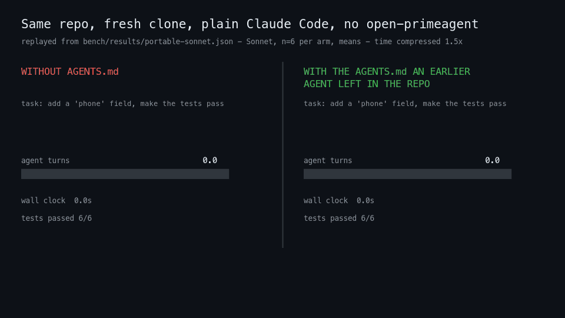

# open-primeagent

[English](README.md) · [한국어](README.ko.md) · **简体中文** · [日本語](README.ja.md)

<sub>本文只翻译了英文 README 的首屏。完整文档和最新内容请看[英文 README](README.md)。</sub>

**Claude Code 花了好一阵子摸清你的仓库。然后同事用 Codex 打开同一个仓库，
Codex 什么都不知道。**

现在每个代理都会自己记东西，但只记给自己：Claude Code 记在 `~/.claude`，Codex 记在 `~/.codex`，
而且只在写下它的那台机器上。open-primeagent 把代理学到的东西写进仓库的 `AGENTS.md` 和 `CLAUDE.md`
里一个带标记的区块，所以它跟代码一起提交，Claude Code、Codex 和 opencode 读到的是同一份。



<sub>回放的是[实测数据](bench/results/portable-deep-sonnet.json)（Sonnet，每组 n=6，取平均），不是摆拍。规则容易重新发现时，收益大约减半：[26%](bench/README.md#p-a-rule-learned-by-one-agent-used-by-the-next-one-without-us---wins-more-when-the-rule-is-hard)。可以用 [`bench/demo_portable.py`](bench/demo_portable.py) 重新生成。</sub>

它只是一个 MCP 服务器，加到你正在用的那个代理上（三者任选）：

- **跟着仓库走的规则。** 装了 open-primeagent 的 Claude Code 在一次会话里找到了仓库的隐藏规则并记录下来。
  一个只带着由此生成的 `AGENTS.md` 的新克隆，用完全没有 open-primeagent 的原生 Claude Code 打开，
  规则难以重新发现时，完成同一个任务的轮数和耗时都少 51%；规则容易发现时少 26%。区块可以用 `opa_bootstrap(remove=True)` 原样移除。
- **跨代理的子代理。** 在 Claude Code 里可以留住一个 Codex 子代理，之后再追问它。
  Claude Code、Codex 和 opencode 现在都能恢复自己的子代理，但碰不到彼此的。
  （Codex 子代理用真实 CLI 手动验证过，CI 里用的是桩程序。）
- **在调用之间一直活着的 Python 进程**，用来放你不想塞进上下文窗口的状态。
  它有没有用，我们还没证明：基准测试的 120 轮里，代理一次也没调用过它。

```bash
claude mcp add opa -- uvx open-primeagent
# Codex 和 opencode 请看英文 README 的 Install。也可以作为 Claude Code 插件安装：
# /plugin install open-primeagent --marketplace softkleenex/open-primeagent
```

### 我们输掉的基准测试

| 实验 | 结果 | |
|---|---|---|
| 用 open-primeagent 学到的规则，由没有它的新代理只通过 `AGENTS.md` 读到（3 个干扰脚本会生成看似合理的错误结果） | 轮数少 51%，耗时少 51% | 赢 |
| 同一实验，规则容易重新发现 | 轮数少 26%，耗时少 26% | 小胜 |
| 同一实验的第一版：代理把规则存成了记忆，其他代理只看得到标题 | 关键事实 6 次里只传过去 4 次 | 输，修复后 6 次全中 |
| 把藏在 16 个干扰脚本里的知识记成规则（8 月） | 耗时减少 57%，波动也变小 | 赢 |
| 同一条规则，但答案一眼就能看到 | 轮数增加 26% | 输 |
| 不新建，而是让已经读过代码的子代理接着干 | 成本降低 81% | 赢，但各代理现在已原生支持 |
| 分给 4 个新的子代理 | 成本增加 777% | 输 |
| 在专门为分派设计的 444 个文件的代码库上分派 | 耗时增加 127% | 输 |
| 持久内核挂了 120 轮 | 调用 0 次 | 没效果 |

输掉的结果我们不删。正是它们让赢的结果可信，而且"为什么输"比数字更有用。[原始数据和方法](bench/README.md)

我们对自己也守同样的规矩。这份 README 原来主打"会话结束后还在的子代理"。
在和各个代理做对比时，我们发现 Claude Code、Codex 和 opencode 今年都已经原生支持了，所以它不再是第一句话。
它还曾承诺区块外的内容一个字都不会改，一次外部审查找到了能打破这个承诺的输入，
[经过写在开发日志里](docs/journal.md#an-outside-review-breaks-the-headline-promise-2026-11-25)。
现在每个安全防护都做了[变异测试](scripts/mutate_guards.py)：故意把它弄坏，确认有测试会失败。

**[其余文档（英文）→](README.md#install)**
